### Walkthrough

I downloaded the zipped file into the /tmp directory using the wget command, i then extracted the zipped folder using the gzip -d command.  I used the mmls command to check the size of the disk partition in the multimedia layer, which revealed a start date of 2048.  i started the sleuthkit instance afterwards, it prompted me for the size of the linux partition for the allocated disk space, i initially incorrectly entered 2048, with the false logic of confusing the start date for the size, but upon further review the length seemed like the only possible answer to the question, giving me access to the flag.

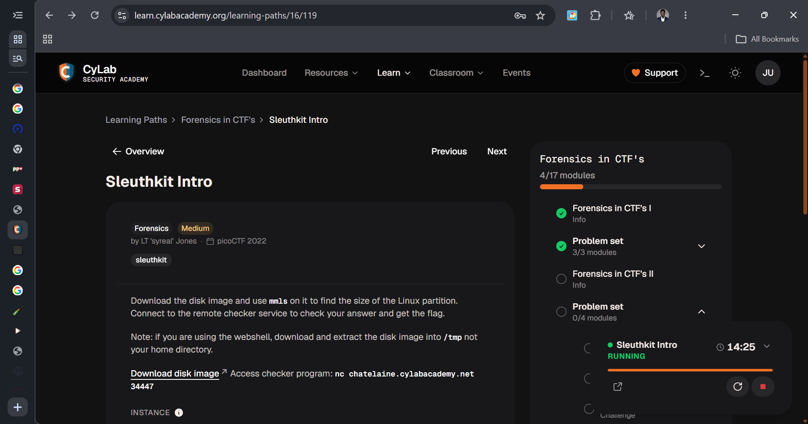

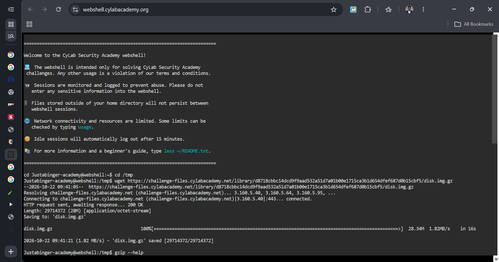

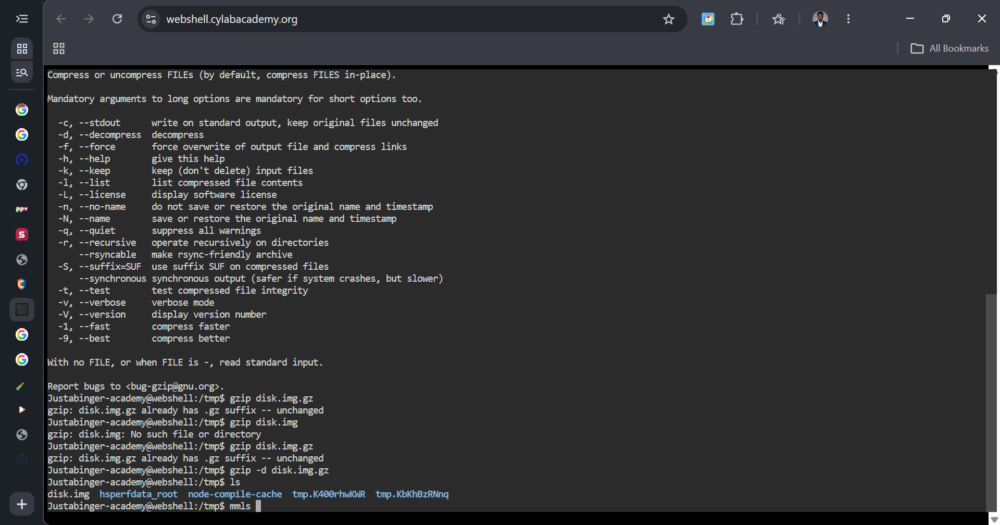

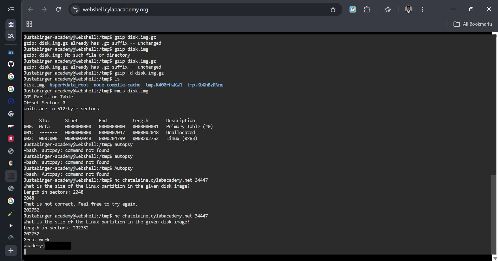

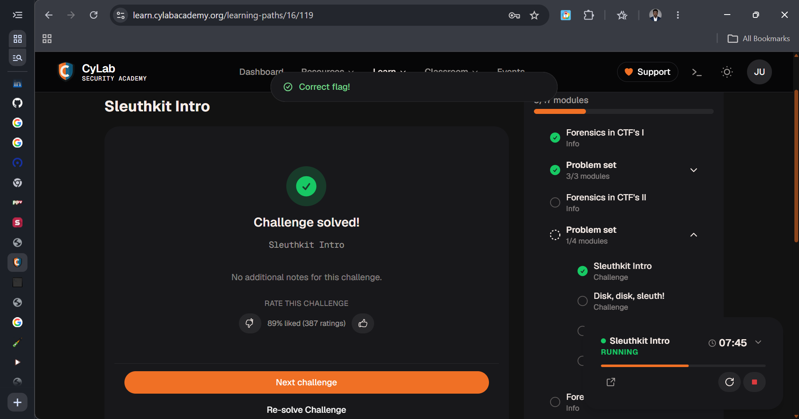

Upon the download and extraction of the file, i used the file command to determine the format of the file, which revealed it was a partitioned disk image. Afterwards, i checked the functionality of the srch_strings command, a sleuthkit functionality to find and display strings inside disk images, i then combined it with the grep functionality using the pipe flag, which revealed the flag to me.

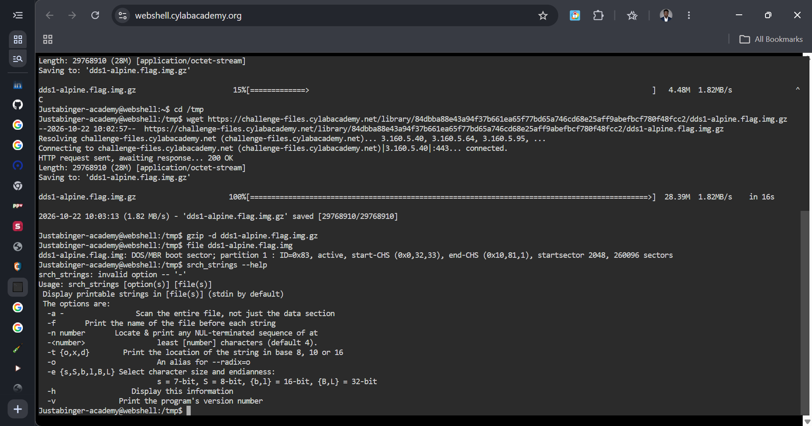

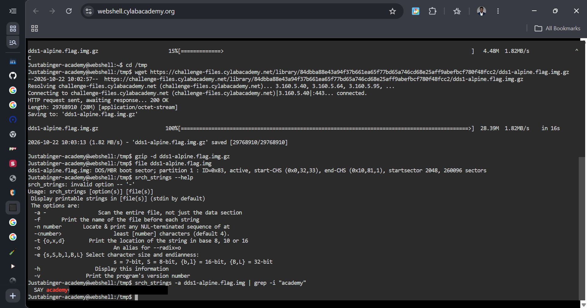

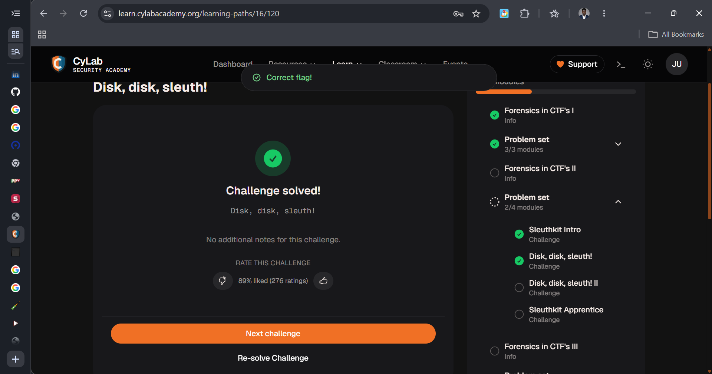

Upon the download and extraction of the file, i used the mmls command to observe what partition i was to focus on in the disk image, then i used ffind piped with the grep functionality to get the inode of the .txt file, once i had the inode of the .txt file, i tried to use the icat option piped with the grep functionality to print the flag, but it was unsuccessful, i then saved the output of the icat command to a new .dat file, and upon using the cat command, discovered why the grep functionality did not work, it turned out the flag was surounded by a multi-byte or wide character encoding, and after several unsuccessful commands, i finally manged to get the flag to be represented in line, which gave me access to copying the relevant sections for the flag. 

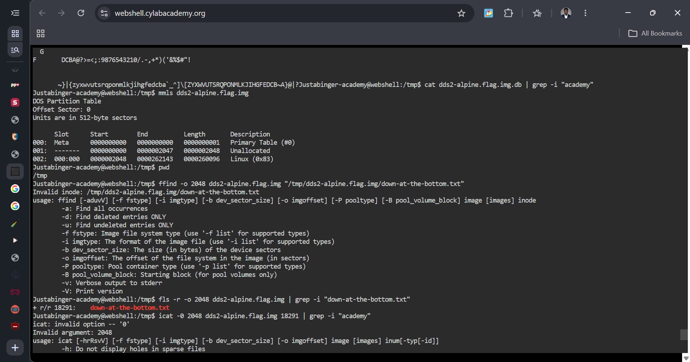

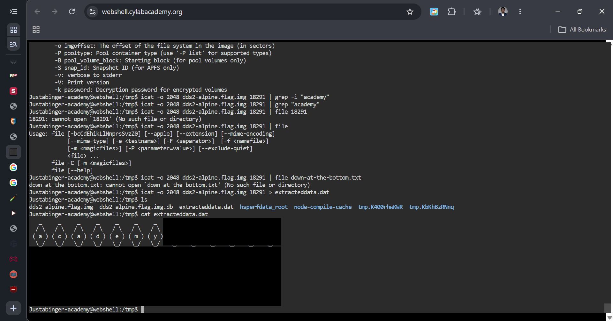

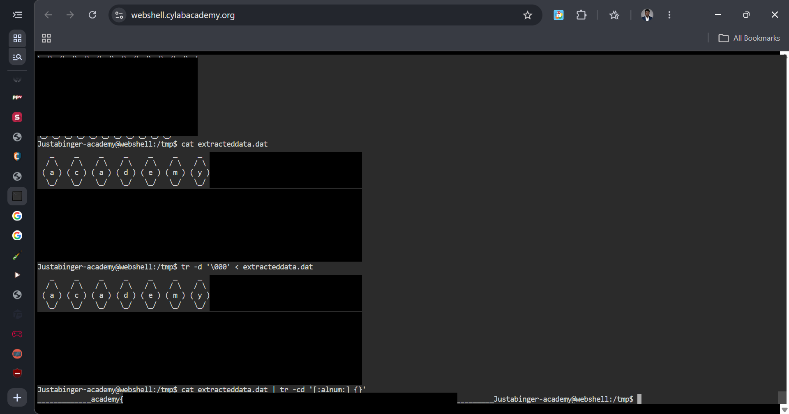

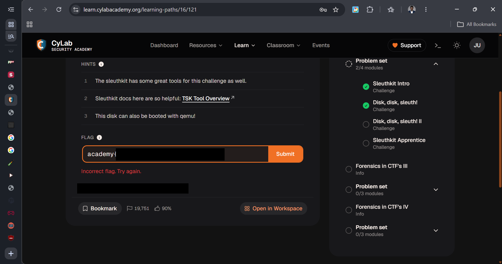

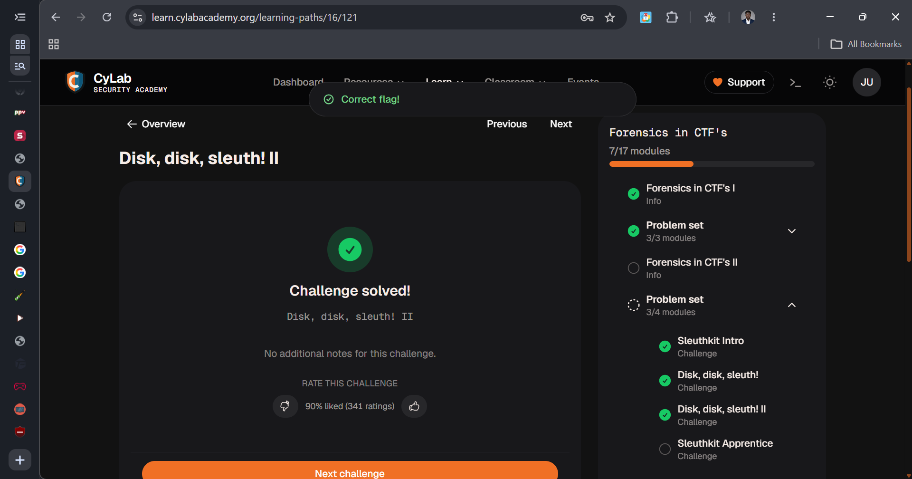

After the download and extraction of the file into the /tmp directory, I used the mmls command to list the partitions present on the disk image, i then used fls on all three partitions to list directories on all three partitions, the manual search revealed flag,txt and flag.uni.txt on the 360448 offset. i initially used the icat [offset_flag] [offset_num] [disk-image-name] [flag.txt's inode num] > example.txt file, i then catenated the contents of the example.txt file, it didn't reveal the flag to me, so i used the inode for the flag.uni.txt and appended the output to the example.txt file, and after catenating the example.txt file again, i got access to the flag.

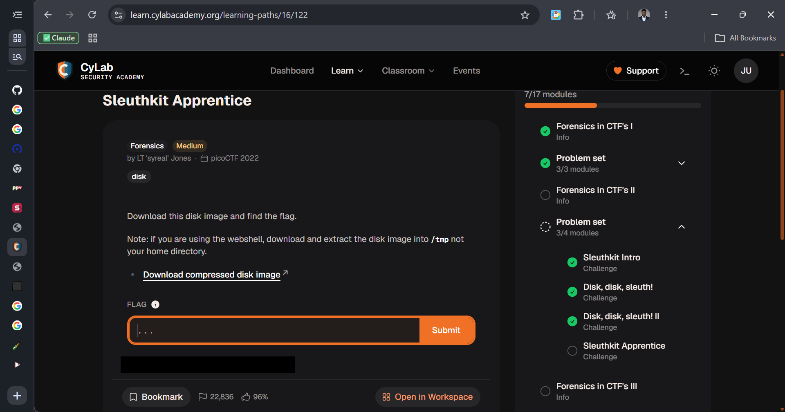

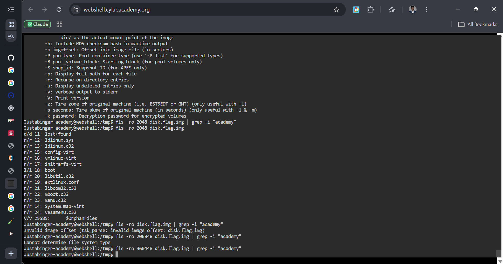

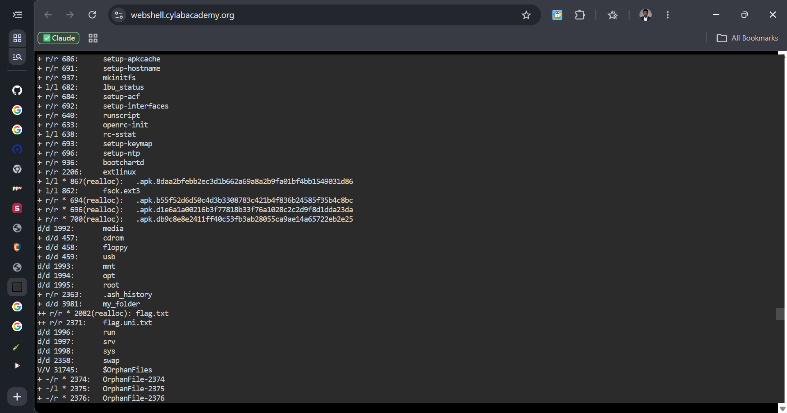
